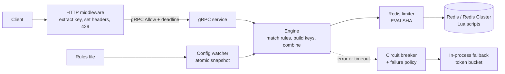

# Distributed Rate Limiter

A rate-limiting service in Go that enforces request quotas across many application servers. Counters live in a shared Redis store, and each allow/deny decision runs atomically inside a Lua script. Three algorithms sit behind one interface, rules are configurable and hot-reloadable, clients talk to it over gRPC or an HTTP middleware, and Redis outages are handled by per-rule failure policies.

**Status:** Phases 1 and 2 of 10 have their core bricks complete (rule configuration with hot-reload; the three Lua algorithms). Everything else below is **planned** and labelled as such. No benchmarks have been run yet. Updated 2026-11-10.

Legend used throughout: **Built** = implemented, **Planned** = designed, not built, **Not yet measured** = no result recorded.

---

## Results at a glance

| Metric                                                             | Value | Conditions | Label                                                                                             |
| ------------------------------------------------------------------ | ----- | ---------- | ------------------------------------------------------------------------------------------------- |
| Admitted requests never exceed the limit (N goroutines, one key)   | n/a   | n/a        | Not yet measured                                                                                  |
| Decision latency P50 / P99                                         | n/a   | n/a        | Not yet measured (working hypothesis P50 < 1 ms, P99 < 3 ms: target only, not a spec requirement) |
| Redis-outage behaviour (breaker trips, fallback engages, recovery) | n/a   | n/a        | Not yet measured                                                                                  |
| Throughput as Redis Cluster shards are added                       | n/a   | n/a        | Not yet measured (stretch; single-host runs will be CPU-bound)                                    |

---

## Why this exists

Without a shared limiter, each server tracks usage on its own, so a client can exceed a global quota by spreading requests across instances. Large APIs run a system like this in front of their endpoints to protect backends, keep access fair between tenants, and limit abuse. This project builds one from scratch as a portfolio-scale learning project.

**Non-goals:** integration into other projects (an AI gateway, a URL shortener); a remote config service as a rule source; any claim of production readiness without measured evidence.

---

## Features

### Three algorithms behind one interface (Lua scripts: **Built**; Go interface and wiring: **Planned**)

One interface takes a key and a cost and returns a decision: allowed, remaining, and retry-after. Each rule picks its algorithm by configuration.

| Algorithm              | How it works                                                                                                             | Trade-off                                                          | When to pick it            |
| ---------------------- | ------------------------------------------------------------------------------------------------------------------------ | ------------------------------------------------------------------ | -------------------------- |
| Fixed window           | Counter per `key:windowStart`, TTL equal to the window                                                                   | Cheapest; allows up to about 2x the limit across a window boundary | Where cost matters most    |
| Sliding window counter | Keeps the current and previous window counts and weights the previous one by how much of it still overlaps               | Approximate but smooth and cheap                                   | Strict fairness            |
| Token bucket           | Stores `tokens` and `lastRefill`; on each request refills `elapsed * rate` (capped at capacity), then subtracts the cost | Allows controlled bursts                                           | Burst-friendly public APIs |

The fixed-window boundary flaw will be shown by a test (**Planned**, task 2.6).

### Atomic check-and-decrement via Lua (**Built** for scripts; Redis-backed tests **Planned**)

A naive read, compute, write cycle from the application lets two requests read the same count and both pass; this race will be demonstrated first (**Planned**, task 2.5). The fix moves the whole decision into one Lua script, which Redis runs atomically on its single thread.

- Scripts are loaded once and executed with `EVALSHA` (**Planned**, task 3.2).
- Time comes from Redis `TIME` inside the script, not from client clocks, to avoid skew between app servers.
- Every key gets a TTL so idle users do not leak memory.

### Configurable, hot-reloadable rules (validation and atomic swap: **Built**; file watching and version logging: **Planned**)

A rule has a match dimension (user, API key, IP, route, or a combination), an algorithm, a limit, a window, and a failure policy. Requests carry a cost, so an expensive endpoint can consume more than one token (**Planned**, task 4.4).

- When several rules match, all are applied and the request is denied if any denies, returning the most restrictive `retry_after` (**Planned**, task 4.3).
- Rules load from a file. A new rule set is validated before it is applied; on failure the old set stays active. The active set is an immutable snapshot behind an atomic pointer, so request paths read without locks.
- Each decision will log which rule-set version it used (**Planned**, tasks 1.5 and 4.5).

### gRPC API (**Planned**, Phases 3 and 6)

Contract from the spec:

```
Allow(AllowRequest{key, ruleId, cost})
  -> AllowResponse{allowed, limit, remaining, retryAfterMs, resetAtMs}
```

Defined in protobuf with stable response fields. Callers set strict deadlines; a timeout triggers the failure policy, because a slow rate limiter is worse than none.

### Standard HTTP headers and middleware (**Planned**, Phase 6)

A Go `http.Handler` middleware extracts a key (pluggable extractors: IP with trusted-proxy handling, bearer token, API key), calls `Allow`, sets headers, and returns 429 when limited.

| Header                  | Meaning                                                      |
| ----------------------- | ------------------------------------------------------------ |
| `X-RateLimit-Limit`     | Limit of the matched rule                                    |
| `X-RateLimit-Remaining` | Remaining quota                                              |
| `X-RateLimit-Reset`     | When the quota resets (unit to be fixed and documented here) |
| `Retry-After`           | Seconds to wait; sent on 429 responses                       |

### Failure policy (**Planned**, Phase 5)

When Redis times out or errors, behaviour is configurable per rule: **fail-open** (allow; protects availability) or **fail-closed** (deny; protects the backend). A per-instance in-process token bucket gives approximate limiting during an outage, and a circuit breaker stops waiting on repeated timeouts and probes for recovery.

### Sharding via Redis Cluster (**Planned**, Phase 8)

Cluster spreads keys across slots, so every key a script touches must land on one slot. The proposed key format is `rl:{<ruleId>:<dimValue>}[:suffix]`, which gives each subject its own slot. Planned checks: slot co-location with `CLUSTER KEYSLOT`, scripts loaded on every master, a scaling run (stretch), and a hot-key demonstration. Known limit: one very busy subject always hits a single shard.

### Metrics (**Planned**, Phase 7)

Counters for allowed and denied by rule, a decision-latency histogram, counters for Redis errors and fallback activations, exposed on a Prometheus `/metrics` endpoint. A Grafana dashboard JSON is stretch.

---

## Architecture



The service is Go; the Lua scripts run inside Redis. The rule snapshot, circuit breaker and fallback limiter run in-process. Per-stage latency budgets are not defined yet.

| Component                             | Path                 | Status       |
| ------------------------------------- | -------------------- | ------------ |
| Rule validation, atomic hot-reload    | `internal/config`    | Built (core) |
| Lua algorithms                        | `internal/redis/lua` | Built (core) |
| Redis client, script manager, limiter | `internal/redis`     | Planned      |
| Engine                                | `internal/engine`    | Planned      |
| Breaker, fallback, policy             | `internal/fallback`  | Planned      |
| gRPC service                          | `internal/server`    | Planned      |
| Middleware, extractors                | `pkg/middleware`     | Planned      |

---

## Design decisions

No ADRs are written yet; each row links once its ADR exists.

| Decision                | Alternative          | Current direction                                            | ADR     |
| ----------------------- | -------------------- | ------------------------------------------------------------ | ------- |
| Time source             | Client timestamp     | Redis `TIME` in the script                                   | Pending |
| Key format and hash tag | Tag on rule id only  | Tag wraps rule id and dimension value                        | Pending |
| Multiple matching rules | Priority hierarchy   | Apply all, deny if any; no refund of tokens already consumed | Pending |
| Failure policy          | One global behaviour | Per rule fail-open or fail-closed, plus fallback and breaker | Pending |
| Algorithm choice        | One algorithm        | Chosen per rule (table above)                                | Pending |
| Rule snapshot           | Read-write mutex     | Atomic pointer to an immutable snapshot                      | Pending |

---

## Quickstart

Not verified here: the commands below were not run while writing this README.

Prerequisites: Go (version pinned in `go.mod`) and Docker for Redis.

```bash
go test -race ./internal/config/...
```

Running the service, the middleware and the Redis-backed tests will be documented as those phases land.

---

## Proof plan

Planned in Phase 9; nothing here is measured yet.

- **Concurrency test:** N goroutines hammer one key and assert the admitted count never exceeds the limit, under `-race`.
- **Benchmark:** P50 and P99 of a decision, with hardware, OS, Go and Redis versions, run count and load method recorded in `reports/`.
- **Outage run:** pause or kill Redis mid-load; record the breaker trip, fallback engagement and recovery.

---

## Repository layout

Verify against the actual tree; entries marked "planned" do not exist yet.

```
internal/config/        rule validation, atomic hot-reload
internal/redis/lua/     fixed_window.lua, sliding_window.lua, token_bucket.lua
internal/redis/         planned: client, script manager, limiter
internal/engine/        planned: rule matching, keys, combine
internal/fallback/      planned: breaker, local limiter, policy
internal/server/        planned: gRPC service
pkg/middleware/         planned: extractors, HTTP middleware
test/                   planned: concurrency, benchmark, outage
docs/adr/               planned: decision records
docs/spec-traceability.md   spec requirement to task mapping
reports/                planned: benchmark and outage reports
TASKS.md                task board and logs
```

---

## Known limitations

- No measured results yet.
- No end-to-end path yet: no Redis client, script manager or gRPC service.
- Verification of Phases 1 and 2 is incomplete: Redis-backed script tests, race and boundary demos, golden vectors, rule-set versioning and file watching are open tasks.
- With several matching rules on different Redis slots, decisions are not atomic across rules.
- A single hot subject stays on one shard.
- Single-machine cluster tests are bounded by that machine's CPU.

---

## Roadmap

| Phase | Focus                                               | Status                                      |
| ----- | --------------------------------------------------- | ------------------------------------------- |
| 1     | Config and hot-reload                               | Core complete; versioning and watching open |
| 2     | Lua algorithms                                      | Core complete; tests and demos open         |
| 3     | Redis client, script manager, first end-to-end call | Next                                        |
| 4     | Engine: keys, rules, cost, combine                  | Planned                                     |
| 5     | Breaker, fallback, failure policy, deadlines        | Planned                                     |
| 6     | gRPC hardening, extractors, middleware, headers     | Planned                                     |
| 7     | Metrics (Grafana is stretch)                        | Planned                                     |
| 8     | Redis Cluster (scaling run is stretch)              | Planned                                     |
| 9     | Proof runs                                          | Planned                                     |
| 10    | README, ADR sweep, final review                     | Planned                                     |

---

## License

Not yet chosen.
